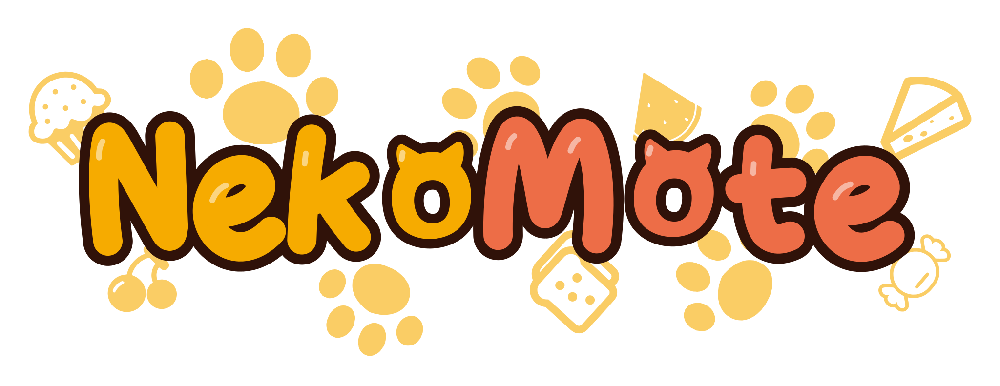

# NekoMote

<div align="center">
  
</div>

NekoMote is an independent C++ implementation of the E-mote 2D character model, designed as a Linux desktop dynamic wallpaper: model evaluation, timeline animation, deformation, masking, physics, and GPU rendering form a complete native playback pipeline built from scratch, with no dependency on browsers, JavaScript, asm.js, or any proprietary core. It currently integrates seamlessly with the unpacked character assets of *NEKOPARA* (normalized by this project's importer after FreeMote unpacking) and runs stably on real desktops over the long term.

It supports model playback, gaze/touch reactions, voice/lip-sync, PNG static and time-of-day dynamic backgrounds, physics sway, mesh deformation, and masking. The rendering backend is OpenGL 3.3 core (default) or Vulkan 1.0, and can run via a KDE Plasma plugin, a standalone Wayland/X11 wallpaper shell, or a normal window.

License: GNU AGPL-3.0 (see [LICENSE](LICENSE)).

## Features

- Independent C++ model evaluation core: parameters, timelines, deltas, deformation, masking, physics, gaze/touch reactions
- Dual OpenGL 3.3 and Vulkan 1.0 backends with runtime switching
- KDE Plasma 6 wallpaper plugin; standalone Plasma 5 adapter (Qt5)
- Standalone Wayland layer-shell wallpaper shell (OpenGL/Vulkan, for compositors supporting the protocol), see [Usage and Validation Scope](docs/layer-shell.md)
- Standalone X11/EWMH wallpaper shell (OpenGL/GLX and Vulkan, Ubuntu 20.04 baseline), see [Usage and Desktop Coexistence Limitations](docs/x11.md)
- Normal window player (GLFW, auto-selects X11 or Wayland)
- Voice and lip-sync (PulseAudio), mutable
- PNG static backgrounds and time-of-day dynamic backgrounds (day/dusk/night three-phase)
- Runtime UI control panel: character/background switching, mute toggle, FPS, lock, position adjustment
- Configuration persistence: explicitly saved startup settings, panel preferences saved independently and automatically, asset directory read-only

## System Requirements

Build:

- CMake ≥ 3.25, Ninja, C++20 compiler (GCC or Clang)
- Python 3 + Jinja2 (GL loader generation)
- libpng 1.6 development package + zlib
- pkg-config + libpulse ≥ 13.99 development package (audio)
- First-time configuration requires network access (CMake FetchContent pulls pinned-version dependencies)

Runtime:

- OpenGL 3.3 core driver; Vulkan backend additionally requires libvulkan (ICD loader)
- X11 or Wayland session + xkbcommon
- PulseAudio (audio; runs muted when unavailable)
- Fontconfig development package (required for build) and a usable TrueType/OpenType font at runtime; CJK/Japanese UI recommends installing Noto CJK

Optional:

- Vulkan SDK (headers + glslangValidator) — enables Vulkan backend build
- Qt ≥ 6.4 Quick/OpenGL — Qt6 host and Plasma6 plugin
- Qt ≥ 5.12 Quick/OpenGL — standalone Plasma5 plugin, explicitly select `NEKOMOTE_QT_MAJOR=5`
- KF6/Plasma 6 development packages — Plasma diagnostic probe (can be disabled in distribution builds)
- Wayland client ≥ 1.20, wayland-scanner, wayland-egl/cursor and EGL ≥ 1.5 — standalone layer-shell shell

FetchContent automatically pulls pinned dependencies: nlohmann/json v3.11.3, fast_float v6.1.6, stb, FLAC 1.4.3, Catch2 v3.5.3, GLFW 3.4, glad 2.0.8. These do not leak into the core library's public headers. System dependency mode (`-DNEKOMOTE_USE_SYSTEM_DEPS=ON`) requires the system to provide equivalent versions (FLAC ≥ 1.4); missing dependencies fail directly with no fallback download.

## Build

```bash
cmake --preset release          # Release + LTO + Vulkan, release build
cmake --build --preset release
```

Artifacts land in `build/release/bin/`: `nekomote_player`, `nekomote_import`, `nekomote_audio_convert`, `nekomote_model_convert`, `nekomote_png_recompress`, `nekomote_abi_host`, `nekomote_preview` (no tests or diagnostic probes).

Other presets:

| Preset | Type | Characteristics |
| --- | --- | --- |
| `dev` | Debug | Warnings as errors, main development preset |
| `system` | Release | Uses distribution system dependencies, no FetchContent downloads; other options same as release |
| `release` | Release | LTO, OpenGL + Vulkan, no tests/probes (release build) |
| `asan` | Debug | ASan/UBSan, does not build preview/player (windowless semantic checks) |
| `plasma` | Release | LTO, Qt6 + Plasma6 QML modules; disables KF6 probe when distributing |
| `plasma5` | Release | LTO, Qt5 + Plasma5 QML modules, does not build KF6 probe/normal window |
| `layer-shell` | Release | LTO, standalone Wayland background process, OpenGL/Vulkan, no Qt/GLFW dependency |
| `x11` | Release | LTO, standalone X11/EWMH background process, OpenGL/Vulkan, no Qt/GLFW dependency |
| `qt-quick` | Release | LTO, Qt Quick isolated host (no Plasma dependency needed) |
| `vulkan` | Debug | Vulkan + validation layer debugging |

Build core and tests in a display-server-free environment:

```bash
cmake --preset dev -DNEKOMOTE_BUILD_PREVIEW=OFF -DNEKOMOTE_BUILD_PLAYER=OFF
cmake --build --preset dev
ctest --test-dir build/dev -LE gpu
```

## Asset Preparation

Assets come from two sources: character models and background images are unpacked from the Steam version of *NEKOPARA*, normalized by this project's importer after FreeMote unpacking; action reaction sessions (gaze, touch, and motion rules) are user-configured and are not part of the original game data.

The runtime only accepts current schema 6 models and version 1 sessions, with no automatic fallback for older formats. Assets live in the `assets/` directory.

You can directly obtain a ready-to-use imported asset bundle (character models, backgrounds, and icons) from the asset repository [NekoMoteAssets](https://github.com/Chocola-X/NekoMoteAssets) and drop it into the `assets/` directory; or import from original materials yourself following the steps below.

Import a single model:

```bash
build/release/bin/nekomote_import \
  model.json model.resx.json --output assets/characters/<character_name>
```

Import a session (reaction rules, gaze, touch regions):

```bash
python3 tools/import_session/import_session.py \
  --reference-root <original_unpacked_asset_root> \
  --model <character_name> --output assets/characters/<character_group>/<variant>/session.nks.json \
  --converter build/release/bin/nekomote_audio_convert \
  --character-root assets/characters/<character_group>
```

Batch import and backgrounds:

```bash
python3 tools/import_all_assets.py --reference-root <original_asset_root> \
  --importer build/release/bin/nekomote_import \
  --session-tool tools/import_session/import_session.py \
  --output assets/characters --report assets/import-report.json
python3 tools/import_backgrounds.py --reference-root <original_asset_root> --dest assets
```

Import artifacts:

| File | Purpose |
| --- | --- |
| `model.nkm` | schema 6 normalized model, MessagePack + zlib compressed container |
| `session.nks.json` | reaction session |
| `textures/N.png` | referenced PNG atlases |
| `audio/main/*.flac` | session voice (FLAC lossless; `little/` is the little-cat voice) |
| `report.json` | structural status and warnings (not playback validation) |

Existing JSON/WAV assets are converted to the current format using the [one-shot migration tool](docs/asset-format.md#现有资产一次性迁移).

Backgrounds go in `assets/backgrounds/`: static PNGs in the root, dynamic backgrounds in the `dynamic/` subdirectory (A/B/C three phases correspond to day/dusk/night).

### Asset Directory Structure

```
assets/
├── characters/
│   ├── characters.json               # Optional, character display name dictionary, key is "group/variant", value is a multi-language object
│   └── <character_group>/            # Top-level directory: character group (e.g. chocola)
│       ├── audio/main/               # Normal voice FLAC (little/ is the little-cat voice)
│       └── <variant>/                # Second-level directory: model variant (e.g. date-a)
│           ├── model.nkm             # schema 6 compressed model (required)
│           ├── session.nks.json      # reaction session (required)
│           ├── meta.json             # Optional: cutoff_y / display_name / hidden / order
│           ├── audio -> ../audio/main # Selects main/little by original voice namespace
│           ├── textures/             # PNG atlases
│           └── report.json           # Import structure report
├── backgrounds/
│   ├── background.json               # Optional, static background display name dictionary (multi-language object)
│   ├── BG_07A.png                    # Static background (root directory, name is the file stem)
│   └── dynamic/
│       ├── background.json           # Optional, dynamic background display name dictionary (multi-language object)
│       └── <group_name>/             # Dynamic background group (e.g. BG_01)
│           ├── config.json           # phases array + transition_seconds
│           ├── A.png                 # Day phase
│           ├── B.png                 # Dusk phase
│           └── C.png                 # Night phase
└── icons/
    └── toggle.png                    # UI panel icon
```

Characters use a two-level directory: `characters/<character_group>/<variant>/`, where each variant directory must contain `model.nkm` and `session.nks.json`. The character name format is `group/variant` (e.g. `chocola/date-a`), used for the `--character` argument and the `character` field in panel config. `characters.json` provides display names, keyed by the full character name.

Display name dictionaries (`characters.json`, `background.json`, `dynamic/background.json`, and `display_name` in `meta.json`) support two value formats: a multi-language object gives translations by language code (`en` / `zh-CN` / `zh-TW` / `ja`); a plain string applies to all languages. At runtime the value is selected by the `language` field in panel config, with missing languages falling back in the order zh-CN → en → zh-TW → ja, and finally to the asset ID. UI panel language switches within the same field, defaulting to English on first launch.

A static background's `name` is the PNG file stem (e.g. `BG_07A`). A dynamic background's `name` is the group directory name (e.g. `BG_01`), and its `config.json` defines each phase's image and switch time:

```json
{
  "phases": [
    {"image": "A.png", "start": "06:00"},
    {"image": "B.png", "start": "16:00"},
    {"image": "C.png", "start": "18:00"}
  ],
  "transition_seconds": 1.8
}
```

`start` is 24-hour HH:MM, and the current phase is selected by sorting by minute-of-day. `meta.json`'s `cutoff_y` is the character crop Y coordinate, `hidden` set to `true` hides the entry from the UI list, and `order` controls sorting within the group.

## Running the Player

```bash
# Directory mode: loads from assets/, UI can switch characters/backgrounds
build/release/bin/nekomote_player --assets assets --character <character_name>

# Single model mode
build/release/bin/nekomote_player \
  --model assets/characters/<character_name>/model.nkm \
  --session assets/characters/<character_name>/session.nks.json --fit

# No-audio environment
build/release/bin/nekomote_player --assets assets --character <character_name> --mute
```

Common arguments: `--backend opengl|vulkan`, `--fit`, `--scale`, `--origin-x/--origin-y`, `--width/--height`, `--fps`, `--seed`, 640×64 range. See `--help` for the full list.

Controls:

- Mouse move: gaze follows; short left-click release: touch; left-click hold after 300ms: drag character; wheel: zoom around pointer
- Space: pause/resume; F: fit full model; R: reset character; Esc: close
- Tab / 1–9: switch character; B / N: switch background; C: clear background
- Top-right icon: open the UI control panel (character and background selection, language, mute, FPS, lock, position reset)

The mute toggle is managed uniformly by the "mute" entry in the UI control panel; its state is written to the `mute` field of the panel config and restored on next launch. `--mute` only forces mute at startup as an override.

The UI and asset display names support English, Simplified Chinese, Traditional Chinese, and Japanese, switchable in the settings drawer of the UI control panel and written to the `language` field of the panel config. First launch defaults to English and deterministically selects the first background in the list as the initial wallpaper; an explicitly cleared background in an existing config keeps the no-background state.

## KDE Plasma Wallpaper Deployment

GitHub distributes `nekomote-plasma{5,6}-{x86_64,aarch64}.tar.gz`. Each archive contains
one `.wallpaper.zip`, its `.sha256`, and a standalone `installer.py`.
Upload the inner **`.wallpaper.zip`** to KDE Store; GitHub users install the same payload
with the script. No global QML import path is required. Store listings still need to be
published separately; see [KPackage distribution](docs/plasma-kpackage-distribution.md).

### Install, Reinstall, and Uninstall

Choose the package matching your Plasma major and CPU architecture:

```bash
tar -xzf nekomote-plasma6-x86_64.tar.gz
cd nekomote-plasma6-x86_64
python3 installer.py              # interactive install/reinstall/uninstall/status menu
# Or run an action directly:
python3 installer.py install
python3 installer.py reinstall
python3 installer.py uninstall
python3 installer.py status
```

Requires Python ≥ 3.8, the matching `kpackagetool5` or `kpackagetool6`, and host runtime
libraries. The installer checks checksums, host versions, and dynamic dependencies before
installing into `$XDG_DATA_HOME/plasma/wallpapers/uk.nekopara.nekomote/`
(default `~/.local/share/…`). Reinstall supports the same version and migrates recorded
legacy split installations, removing their old libraries, modules, and generated environment
file. Failure restores the original files; modified legacy files stop the operation before
any changes. Assets, panel state, and desktop configuration are retained.
After an update or migration, log out and back in to release loaded modules; the installer
does not restart the desktop. Select NekoMote in Configure Wallpaper and choose your assets directory.

### Building the Plugin from Source

```bash
cmake --preset plasma -DNEKOMOTE_BUILD_PLASMA_PROBE=OFF
cmake --build --preset plasma --target nekomote_plasma_stage
```

For Plasma 5 use the `plasma5` preset. The stage is a packaging intermediate;
see [Plasma distribution](docs/plasma-distribution.md) for bundle generation.
The previous `plasma_deploy.py` deployment path has been removed.

### Distribution Packages

Distribution maintainers can use `-DNEKOMOTE_USE_SYSTEM_DEPS=ON` (or `cmake --preset system`)
to use system-installed dependency versions; missing dependencies fail directly with no pinned-version download.
Default builds and GitHub Actions continue to use the existing pinned dependencies.
Arch's three-package PKGBUILD is in [packaging notes](packaging/arch/README.md).

Five independent GitHub Actions workflows build on branch push, PR, or manual trigger:

- Ubuntu 20.04: x86_64 / ARM64 Release builds of `nekomote_player`, `nekomote_import`, `nekomote_audio_convert`, `nekomote_model_convert`, `nekomote_png_recompress`, `nekomote_abi_host`.
- KDE5: Ubuntu 20.04 / Qt5.12.8 x86_64 and ARM64 plugins.
- KDE6: Debian 12 / Qt6.4.2 x86_64 and ARM64 plugins.
- Layer-shell: Debian 12 / Wayland 1.21 x86_64 and ARM64 standalone programs.
- X11: Ubuntu 20.04 / EWMH/GLX x86_64 and ARM64 standalone programs.

After build, tests, and dependency audit pass, Actions artifacts are uploaded; failure logs and test reports are saved separately.
Pushing a stable `vX.Y.Z` tag such as `v0.5.0` triggers the release workflow, which builds all the above platforms,
verifies the ten archives and their SHA256, and publishes to GitHub Releases automatically.
Archives do not bundle the README; the project license is AGPL-v3, and the required dependency notices are merged into
`THIRD_PARTY_NOTICES`. Plasma licenses and notices live in `contents/` inside the wallpaper ZIP.
See [Automated Build Notes](docs/github-actions.md) for configuration and compatibility;
installation commands are listed above.

The plugin uses the host Qt public Quick API; distribution packages do not bundle Qt/KDE/glibc/GPU drivers. A single binary cannot cover all Linux distributions: a Qt plugin requires the same Qt major and a Qt minor no lower than the build. See [Plasma Distribution](docs/plasma-distribution.md). The Plasma 5 package (`nekomote-plasma5-*`) follows the same steps but must be installed into a Plasma 5 desktop, never Plasma 6.

## Standalone Wallpaper Shells (Wayland layer-shell / X11)

When not using the Plasma plugin, two standalone process shells can connect the same wallpaper body to other desktops. Both reuse the shared model, background, voice, control panel, and config via the C ABI only, duplicating no business logic:

- **`nekomote_layer_shell`**: targets Wayland compositors that implement the [wlr-layer-shell](https://gitlab.freedesktop.org/wlroots/wlr-protocols/-/blob/master/unstable/wlr-layer-shell-unstable-v1.xml) protocol (Sway, Hyprland, niri, etc.), supporting OpenGL/EGL or native Wayland Vulkan output.
- **`nekomote_x11`**: targets any X11 window manager implementing EWMH, persisting as a desktop-layer window (`_NET_WM_WINDOW_TYPE_DESKTOP`), supporting OpenGL/GLX or native Xlib Vulkan output, Ubuntu 20.04 baseline.

### Build and Run

```bash
# Wayland layer-shell shell (requires Wayland client ≥ 1.20, wayland-scanner, EGL ≥ 1.5)
cmake --preset layer-shell && cmake --build --preset layer-shell
build/layer-shell/bin/nekomote_layer_shell --list-outputs
build/layer-shell/bin/nekomote_layer_shell --assets /path/to/assets --output DP-1 --backend vulkan

# X11/EWMH shell (requires X11, RandR ≥ 1.3, GLX development files)
cmake --preset x11 && cmake --build --preset x11
build/x11/bin/nekomote_x11 --list-outputs
build/x11/bin/nekomote_x11 --assets /path/to/assets --output HDMI-1 --backend vulkan
```

Both share a largely identical command-line contract:

| Argument | Meaning |
| --- | --- |
| `--assets DIR` | Formal asset directory, shares character/background scanning, switching, and control panel |
| `--backend opengl\|vulkan` | Selects backend, default OpenGL; fails explicitly if Vulkan is not compiled or initialization fails |
| `--output NAME` | Binds to the specified output; the process exits cleanly when that output is removed. If unspecified, layer-shell lets the compositor choose, X11 picks the primary output |
| `--input interactive` | Default; receives local pointer where the background is visible, forwarding to shared UI and model interaction |
| `--input passthrough` | Empty input region, fully transparent; cannot operate the control panel or touch interaction |
| `--config FILE` | Explicitly specifies the startup config file |
| `--state FILE` | Explicitly specifies the panel preferences file |
| `--save-config` | Saves the merged startup settings and exits, no display server needed |
| `--mute` / `--no-save` | Force mute / do not write config |
| `--model FILE [--session FILE]` | Single-model diagnostic entry, does not draw the asset control panel |
| `--frames N [--capture FILE.ppm]` | Fixed 1/60-second step diagnostic replay, reads the framebuffer only once at the final step |

Both shells support `--ui-open`, which expands the control panel on interactive-mode startup.

For multi-monitor setups, launch one process per output with an explicit `--output`; secondary monitors should add `--mute` to avoid simultaneous audio from each instance. Do not run multiple wallpaper programs on the same output. Independent instances should each specify `--config FILE`; config identity is not derived from the output name.

Both shells are off by default and do not depend on Qt/GLFW; missing protocol capabilities (a compositor without layer-shell, a WM without EWMH support) cause an explicit failure exit rather than degrading to a normal window. Applicable scope and validation boundaries are in [layer-shell notes](docs/layer-shell.md) and [X11 notes](docs/x11.md) (the latter covers the known XFCE desktop-icon coexistence limitation).

## Configuration

Startup config and panel preferences are saved separately to the XDG config directory; `assets/config.json` is never read or written, and there is no default asset directory.
`--config FILE` selects the startup file; only `--save-config` writes it and exits; a normal launch reads saved values and then applies explicit command-line overrides.
The panel file defaults to `<startup_file_stem>.panel.json` in the same directory, or can be specified via
`--state FILE`. Plasma startup settings are managed by the plugin; the panel is isolated per wallpaper instance UUID.

```bash
nekomote_x11 --config ~/.config/nekomote/left.json --assets /path/to/assets \
  --backend vulkan --output DP-1 --save-config
nekomote_x11 --config ~/.config/nekomote/left.json
```

Panel preference fields:

| Field | Description |
| --- | --- |
| `character` | Current character name |
| `background` | Current background name (file stem for static, group name for dynamic) |
| `scale`, `origin_x`, `origin_y` | Character scale and center origin position (Y downward) |
| `fps` | Display frame rate limit (author clock stays 60Hz) |
| `mute` | Mute state (maintained by the UI panel) |
| `lock_transform` | Locks character position and size |
| `fit` | Fit full model |
| `icon_x`, `icon_y` | UI icon position |
| `sidebar_x`, `sidebar_y`, `sidebar_free` | UI panel position and free-floating |
| `background_fade_seconds` | Background switch fade duration |

Panel data is saved only on user action; first launch and exit do not create a file for default values.
`--no-save` keeps the original config without writing back. Paths, instance isolation, JSON examples, and one-shot legacy config migration commands are in
[Configuration Notes](docs/configuration.md).

## Performance

On 2026-10-18, the current build was reinstalled on a real Wayland / KDE6 desktop and compared against a static-image background and the dynamic wallpaper.
The machine is a Xeon E5-1680 v4 / RTX 3080 Ti, single monitor 2560×1440, 180 Hz, wallpaper target 60 FPS.
Two-round sampling mean, **Plasma Shell delta** relative to a clean static baseline before and after:

| Backend | Single logical CPU usage delta | RSS delta | Process VRAM delta |
| --- | ---: | ---: | ---: |
| OpenGL | +17.7 percentage points | +42.4 MiB | +69.0 MiB |
| Vulkan | +17.9 percentage points | +84.1 MiB | +88.7 MiB |

CPU 100% equals one logical CPU; the above deltas are roughly 1.1% of this machine's 16-thread whole-machine baseline.
Vulkan's two-round RSS ranged 559–628 MiB, with an as-yet-unlocated startup footprint difference; resources also remain resident after switching back to static.
KWin overhead, whole-card power, per-second data, and recovery checks are in [Real Desktop Usage Report](docs/plasma-desktop-2026-10-18.md).
This is a short measurement; actual present frame rate was not measured, and the results do not represent other hardware or long-term operation.

Historical standalone player measurements (1920×1080, 60 FPS, OpenGL, full character + background + UI):

- Memory usage: ~140 MB
- VRAM usage: ~60 MB
- Core evaluation (parameter advance, physics and geometry build) single-frame P50 ~0.45 ms, ~3% of a single core at 60 FPS; excludes drawing, UI, and desktop compositing

Multi-backend comparison, memory behavior under continuous multi-character switching, and detailed measurement methodology are in [Memory Footprint Report](docs/memory-footprint-2026-10-12.md) and [Long-Run Audit](docs/performance-audit-2026-10-16.md).

## Diagnostic Tools

- `nekomote_preview`: component-level preview and screenshots
- `nekomote_abi_host`: C ABI isolated host, deterministic replay and screenshots (`--assets`/`--model`/`--steps`/`--capture`/`--mute`)
- `nekomote_playback_probe`, `nekomote_session_probe`, `nekomote_frame_render`: per-frame numerical and GPU frame observation

Fixed-step screenshots must be muted (`--mute --steps N --capture out.png`), are independent of performance measurement, and are not mixed into performance benchmarks.

## Project Structure

```
src/model        Strongly-typed assets and math foundation
src/runtime      Parameter, scene graph, animation, deformation, physics evaluation
src/asset_io     Asset loading and image decoding
src/abi          C ABI wallpaper instance (host integration boundary)
src/render_gl    OpenGL backend
src/render_vk    Vulkan backend
src/application  Session, Controller, config, multi-model switching
src/ui           Shared control panel and layout
src/host_qt_quick Qt Quick shared host foundation
adapters/plasma  Plasma 6 wallpaper QML module
adapters/plasma5 Plasma 5 adapter (Qt5 plugin registration and entry)
adapters/layer_shell Standalone Wayland layer-shell shell
adapters/x11     Standalone X11/EWMH shell
apps/player      Normal window player
apps/abi_host    C ABI diagnostic host
apps/preview     Component preview
tools            Import, distribution, and verification scripts
```

Module boundaries, performance specs, and development conventions are in [AGENTS.md](AGENTS.md); the development roadmap is in [ROADMAP.md](ROADMAP.md); build details are in [docs/building.md](docs/building.md).
