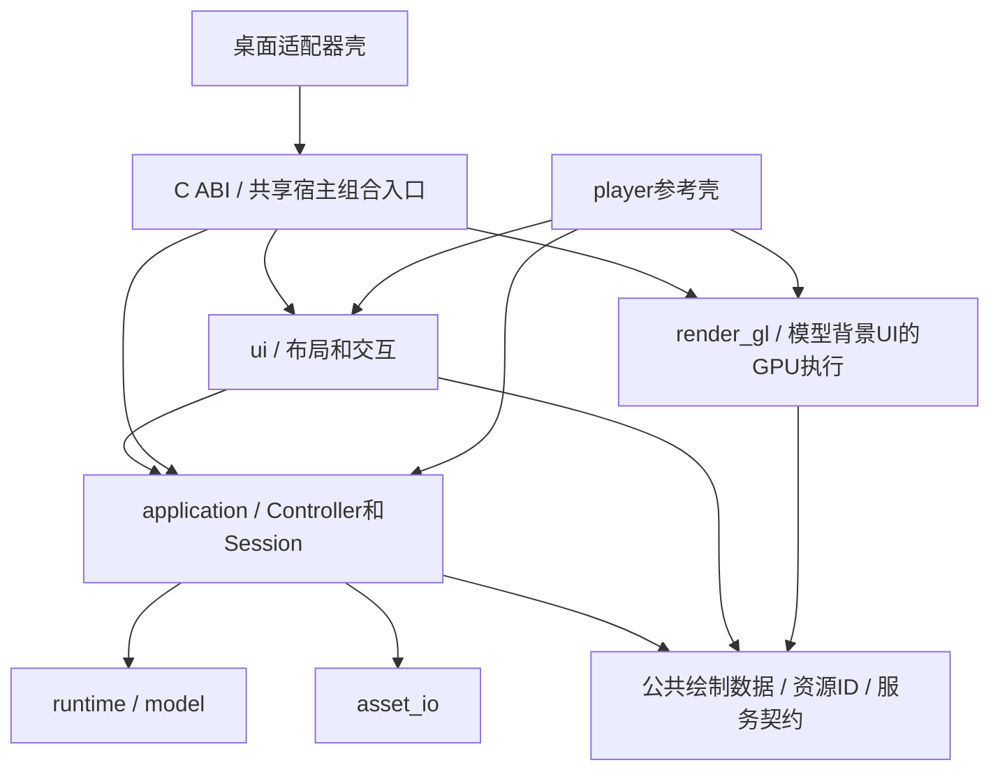

# NekoMote 开发路线图

版本：执行中，2026-10-12。GLM 已交付共享 Controller/UI、GL 执行、高层 ABI 和 Plasma 接入；显示阶段起点 `7029eda`，当前 C12 基线 `cfed43e`。用户优先隔离用户桌面效果，Codex 完成显示补修及隔离包验证，用户已确认实际桌面初步接入正常。G31/G32 不再列为未实现，但完整边界与服务验收仍有缺口；见 [摘要](docs/review-agents-current.md)、[显示补修](docs/plasma-display-fix.md)。application/ui 保持图形 API 解耦，player 的 Vulkan 1.0 双栈实现已由 C11 重写，见 [后端契约与验收](docs/vulkan-backend.md)；C12 已复核 Vulkan C ABI 并接入 Plasma 双后端，默认 OpenGL，见 [接入与验收](docs/plasma-dual-backend.md)。GitHub 基线构建配置已准备，容器/远端/跨发行版运行尚未验证，见 [分发](docs/plasma-distribution.md)。

C13 优化复核基线 `3a56ce0`：明确撤销不安全建议，清理死接口并验证局部帧路径与候选加载；见 [审查](docs/optimization-audit-2026-10-12.md)。P7 继续按实测热点推进，下一批 G34 消除重复几何编译；本轮不替代跨发行版或全模型动态认证。

## 1. 产品与开发策略

NekoMote 独立实现原生二维模型运行时，使用已有 E-mote 解包素材，目标是在 Linux 桌面长期运行动态壁纸。动画/变形核心、GPU 后端和桌面适配分别组织，共用真实模型开展开发和验证。

开发阶段以性能和代码规范性为优先约束，允许破坏性修改 API、资产格式和模块组织；统一迁移当前调用者并删除旧实现，不维护兼容层。原素材的视觉和行为还原仍是功能验收目标。

主路线为独立源码实现。旧 asm.js 转原生产物仅保留调查记录，不作为此路线图的必需依赖，也不并行维护两套运行时。

范围包括：素材导入、参数/时间线、场景图、变形、遮罩/混合、物理、反应/音频、原生预览和桌面适配。第一版以本项目素材集合为目标，不扩展为 Live2D 播放器或通用游戏引擎。

## 2. 仓库现状与输入来源

### 2.1 工作区

- 新项目：本仓库根目录。
- 原项目：同级目录 `../NekoWebShow/`，调查基线 `main` / `47751f6a2cbce50ed7b1cdc8727e4d4bacf83b0e`。
- 原项目目录当前有 195 条模型目录记录；完整原生兼容性尚未验证。
- 本地 `refer/` 保存旧调查报告和参考源码，已被 Git 忽略。
- 当前开发环境：KDE / X11，CMake 4.0.3、Ninja 1.12.1、GCC 15.1.1、Clang/clang-format 20.1.8。仅用于说明当前环境，不把这些精确版本强制写成未来最低要求。

用户已批准路线规划和开发规范；阶段状态依据当前源码与可复核证据。历史交接不能替代当前HEAD回归，接手时核对Git状态并保护他人工作。

### 2.2 本地材料索引

| 资料 | 路径 / 用途 |
| --- | --- |
| 前期可行性报告 | `refer/linux-native-feasibility.md` |
| Live2D 与独立引擎报告 | `refer/live2d-native-rendering-study.md` |
| E-mote 接口 | `refer/FreeMote-SDK/WebGL/driver/iemote.h` |
| PSB 格式参考 | `refer/psbfile/` |
| Cubism 公开模块 | `refer/CubismNativeFramework/`、`refer/CubismNativeSamples/` |
| 真实模型主体 | 原仓库 `model_conversion/<角色>/<型号>/<型号>.json` |
| 资源映射与纹理 | 同目录 `.resx.json` 与资源目录 |
| 型号目录 | 原仓库 `config/model-catalog.json` |
| 展示参数 | 原仓库 `config/model-presentation.json` |
| 反应规则 | 原仓库 `config/reaction-library.js` 和角色配置 |
| 网页行为参照 | 原仓库 `driver/`、`main.js` |

旧报告中 `tools/` 是移动前的路径，当前对应 `refer/`。报告内的原项目相对路径应在原仓库解析，不在本项目创建同名文件来凑路径。

参考库不属于正式依赖。尤其不能把 Cubism GPU Renderer 当作开放的模型求值核心，也不能默认其许可允许直接移植。`refer/inochi2d/` 的 Agent 限制已在调查报告说明，继续处理前应遵循适用指令。

正式构建不依赖 `refer/` 或上述绝对路径。开发工具接受显式素材根目录；测试使用可提交的小型合成样例，真实素材和参考截图保留在显式配置的外部位置。

## 3. 技术决策与模块结构

### 3.1 初始技术选择

| 项目 | 初始选择 | 调整条件 |
| --- | --- | --- |
| 语言 | C++20 | 真实构建/宿主要求有证据时调整 |
| 构建 | CMake + Ninja，统一 presets | P0 冻结实际最低版本和编译器矩阵 |
| 图形 | 首个 OpenGL 后端，候选基线 OpenGL 3.3 | GPU 能力及 Plasma 宿主图形后端核对后决定；不得全局修改桌面配置来掩盖问题 |
| 调试宿主 | 轻量普通窗口，优先评估 GLFW | P0 核对安装与构建；核心不依赖窗口库 |
| 开发素材 | 解包 JSON + PNG 图集 + 资源映射 | 导入器产生项目自己的当前 schema |
| 运行时素材 | 强类型模型资产；只支持当前格式 | P7 决定是否增加紧凑二进制编码 |
| 首个桌面 | Plasma，依据当前 KDE 环境 | 用户指定其他首发目标时重排适配阶段 |
| 其他桌面 | layer-shell，其后 GNOME/X11 独立适配 | 先确认实际协议/宿主能力，按目标逐项实施 |

依赖库和版本在 P0/P1 选定并记录，避免只为了目录规划提前引入所有库。PNG、JSON、窗口等库限在相关目标内，不进入核心公共头文件。

### 3.2 目标组织

以下是目标目录，随阶段需要逐项建立：

```text
include/nekomote/            跨模块/宿主的公共契约（C ABI + C++ 公共头）
src/model/                  不可变资产、实例数据、强类型 ID
src/runtime/                参数、场景图、变形、动画、物理
src/asset_io/               当前项目资产加载、校验和解码
src/render_gl/              模型/背景/UI绘制协议的OpenGL执行与GPU资源管理
src/application/            壁纸会话、多模型编排与切换、资产扫描、配置 schema、反应、背景层管理与渐变、输入处理、音频协调
src/ui/                     后端无关控制 UI、布局/hit-test/事件路由、绘制数据
src/abi/                    C ABI，暴露 application + ui 给宿主
src/audio/                  PCM 设备服务
src/host_qt_quick/          Qt Quick 宿主封装（SessionItemBase）
apps/player/                GLFW 壳（参考实现）与诊断入口
apps/abi_host/              C ABI 完整壁纸功能验证
apps/preview/               独立预览与诊断
apps/qt_quick_host/         Qt Quick 独立宿主
adapters/plasma/            Plasma 壳：QQuickFramebufferObject + 生命周期 + assetsDir
tools/import_emote/         离线导入与资源编译
tools/reference_capture/    原网页的受控采样与对照工具
tests/unit/                 无显示服务器的语义测试
tests/render/               GPU 图像/生命周期测试
tests/fixtures/             小型、来源明确、可提交的样例
benchmarks/                 求值/渲染及加载基准
docs/                       格式、语义证据、架构决策和性能报告
```

不要一次性创建所有目录、空类或图形后端接口。实际 CMake 目标可合并初期的小模块，但源码与公共接口须保持职责边界；拆分依据真实依赖。

### 3.3 依赖方向

下图箭头表示模块依赖；服务实现经边界注入，不要求所有能力位于一个目标。



application不依赖ui，render_gl不依赖application/UI业务状态。application/ui的输入输出不含OpenGL/Vulkan对象或shader；新后端实现同一绘制/资源契约，不改壁纸业务与UI。GL / Vulkan 复用同一绘制数据与 UI Painter，宿主负责设备和呈现；不建立复杂后端工厂。布局/命中及显示尺寸与设备像素的转换有明确契约，不能依赖GL viewport状态推定逻辑布局。

player在G31阶段直接用共享C++接口验证；桌面适配器只经C ABI调用共享功能，不直接调用ui/application C++。图形上下文/输出目标由壳提供，GPU资源由后端拥有，CPU业务状态由Controller拥有；异步加载和GUI事件经有界交接进入同一求值线程，详细契约见[专项交接](docs/wallpaper-application-handoff.md)。

## 4. 阶段地图与完成状态

下表记录当前实测状态。只在退出条件全部有证据时更新为“完成”；失败、近似和阻塞单独记录。

| 阶段 | 目标 | 前置 | 主要交付 | 状态 |
| --- | --- | --- | --- | --- |
| P0 | 工程骨架与验证环境 | 本规划 | 构建、检查入口、边界、样例路径 | 完成 |
| P1 | 素材审计与导入规范 | P0 | 字段/能力矩阵、当前 schema、导入工具 | 完成 |
| P2 | 原生静态绘制基础 | P1 | 图集、几何、目标、单帧对照 | 完成 |
| P3 | 参数、场景图与网格变形 | P1、P2 | 参数求值和经验证的变形 | 进行中：代表静态30/30与播放矩阵通过；单边界0x7fc挂接已正式验证，嵌套/cc等新范围仍待验证 |
| P4 | 遮罩与完整静态合成 | P3 | 一个复杂模型的正确静态画面 | 代表范围通过：真实add_mask修复，Fraise400零超差；bm19/attr2映射已实现并新增9/9；Fraise-b受控镜像/可选遮罩范围已闭合；嵌套仍未验证 |
| P5 | 时间线、差分与动态播放 | P4 | 可控动态播放器 | 已实现独立动态播放；当前冻结代表动画/眼睛/差分/缩放/物理矩阵全通过，新增型号需逐项验收 |
| P6 | 物理、反应、背景、音频与壁纸应用层 | P5 | 完整原生预览体验 + 可复用壁纸应用层 | 代表会话/声音、薄C宿主已实现；触摸坐标/区域诊断、背景暂停/250ms预算和C++候选事务已验证；195初态可求值，触摸证据工具已修，视觉/区域候选、正式Plasma声音背景、UI隔离、角色渐变及背景reset待闭合；WallpaperController/UI/GL 执行已提取，player 与 ABI 面板业务重复及完整服务验收待收拢 |
| P7 | 资产与稳态性能优化 | P6 | 当前资产打包与性能基线 | 进行中：核心零分配基线存在；新WebGL收益结论方法未闭合，资产/依赖/UI稳态与打包待验收 |
| P8 | 首个 Plasma 适配器（壳） | P6,P7 | 原生桌面壁纸 | 高层 ABI/Plasma 壳及安装包已实现；本轮 UI/背景接线、隔离动态包、DPI/输入/生命周期通过；用户确认实际桌面初步接入正常；多屏/长期及完整边界仍待验收 |
| P9 | 全素材覆盖与长期运行 | P8 | 型号矩阵、稳定性和生命周期报告 | 部分CPU审计已开展：当前195结构与初态CPU OK、15旧加载缺口解除，视觉/交互认证待补；8–24小时与桌面生命周期未进行 |
| P10 | 发布与其他桌面扩展 | P9 | 可安装产物、按目标新增适配器 | 尚未发布：本地安装/卸载工具已实现，来源/许可及发布验收待闭合；其他桌面延后 |

P1 的素材调查和 P2 的通用 GPU 基础可交错推进；P3/P4 的语义门槛未通过时，不将其下游功能当成已具备能力。

### 当前执行顺序

1. 显示补修与左键手势已提交（`cd911cd`、`8f9f4dd`）；用户已确认实际桌面初步接入正常。此反馈与隔离自动证据分别记录，进入服务与完整边界收拢。
2. GLM 已交付 G31/G32 源码，不再执行旧抽取清单。后续优先收拢 player/ABI 的面板业务、FPS/静音联动及服务契约测试；开始前明确边界和退出条件。
3. Codex 复核时间、线程/资源/ABI 与语义反例，Gemini 检查固定条件下的桌面/UI 图像与交互。G27/G28/G29/V19 报告按真实范围复核，不无理由重跑。
4. 嵌套/2标量、195全动态、正式声音、完整桌面生命周期、8–24h/多屏仍分别验收。Vulkan 复用同一业务/绘制数据，但资源 ID/设备解析需闭合，不创建空后端。

执行范围、迁移阶段与验收见[专项交接](docs/wallpaper-application-handoff.md)和[任务交接](docs/agent-next-handoff.md)。

## 5. P0：工程骨架与验证环境

### 工作项

1. 建立最小 CMake 工程、目标级依赖、dev/release/asan presets。
2. 配置 clang-format、编译警告和静态检查；记录 GCC/Clang 的可验证构建入口。
3. 选择具体窗口、PNG/JSON、测试依赖并固定版本；评估其许可与实际构建影响。
4. 定义坐标、矩阵、时间和 alpha 约定，以及资产/实例/图形资源的所有者。
5. 建立外部素材路径配置和测试样例策略；不把本机绝对路径提交进构建。
6. 建立最小预览窗口与图形能力诊断，记录 GPU/驱动；渲染首帧与退出能够释放资源。
7. 设计性能记录格式，暂不承诺优化收益。

### 交付与退出条件

- 无窗口的核心目标和独立预览目标能分别构建。
- 一种正式选择的窗口/图形链能显示诊断图形并正常退出。
- 空白场景生命周期没有资源错误；ASan/UBSan 覆盖可适用的路径。
- 缺少 `refer/` 仍能配置和构建；缺素材只影响显式素材操作。
- Presets 和检查命令可按文档复现，不写不存在的脚本。

P0 建立后预期统一入口可为 `cmake --preset dev`、`cmake --build --preset dev`、`ctest --preset dev`。这三个入口已在 P0 建立并可执行。

## 6. P1：素材审计、语义清单与导入器

### 工作项

1. 从 195 条目录记录建立型号 → PSB/JSON/resx/PNG/规则的显式映射；处理别名与缺失素材，例如 `milk-teenage.pure` 和待补全的 `milk-winter`。
2. 区分元数据和影响画面的字段。为未知字段建立状态：未调查、候选语义、已验证、不支持。
3. 审计引用、嵌套 motion、图层树、参数范围、frameList、mesh、继承和遮罩特征。
4. 制定项目自己的强类型模型 schema；保留源字段路径和导入诊断，不把原 JSON 直接带进热路径。
5. 实现离线导入 CLI：显式输入根目录、型号、输出目录与能力报告。
6. 保留 null/缺字段/0 的区别，校验引用和数值；未知必需语义明确报错。
7. 导出项目反应规则时处理 JS 中的组合/函数，不做文本替换式 JSON 转换。
8. 定义受控网页采样方式：固定模型、变量、背景、分辨率、时间和可关闭的物理影响。

### 首批样例

- `chocola-date-a`：已有非空网格、参数化和遮罩字段，作为主样例。
- 一个幼年体型和一个不同角色模型：检验字段/空间假设。
- 一个有配件或特殊服装的模型：检验引用和层次变化。
- 小型合成样例：单图层、变换、插值、遮罩、参数组合，作为可提交测试。

### 交付与退出条件

- 有覆盖整个目录的资产/特征报告，无法导入的型号有具体原因。
- 主样例的资源引用与图集信息正确，结构规范化确定且可复现。
- schema、字段证据记录格式与导入错误契约有文档。
- 先生成完整中间数据，不以删除 mesh/遮罩等复杂信息取得“导入成功”。

此阶段不宣称能播放模型；导入通过只代表结构与资源可用。

## 7. P2：原生静态绘制基础

### 工作项

1. 实现项目资产加载与 PNG 图集上传，建立资源 ID → GPU 对象映射。
2. 建立静态顶点/UV/索引缓冲、普通 over 合成和宿主提供的 render target。
3. 验证图集区域、裁切、原点、像素/模型坐标、Y 轴和透明边缘。
4. 生成最小绘制协议；保持顺序，不为多后端预先建设复杂框架。
5. 增加局部部件/节点查看、固定变量输入和能力诊断。
6. 实现 CPU 资产和 GPU 资源独立释放，覆盖载入失败与 resize。

### 交付与退出条件

- 合成样例和真实素材中的无变形/无遮罩部件能正确呈现。
- PNG 只加载上传一次，重复帧复用缓冲和目标。
- 输出尺寸、缩放、透明度和图集坐标有可复查对照。
- 能捕获单帧用于诊断；截图读回隔离在诊断路径。
- 主模型尚缺少的变形/遮罩明确报告，不将部件能画当作完整模型通过。

记录第一份 GPU/CPU 帧基线。此时主要验证基础正确性，不以不完整模型估计最终消耗。

## 8. P3：参数、场景图与网格变形

### 工作项

1. 建立变量 ID、范围、默认值和来源贡献，支持固定变量求值。
2. 处理层级、transformOrder、翻转/斜切和透明度/颜色继承。
3. 通过受控单变量实验确定 parameterize、division、discretization 及资源切换。
4. 分析 `mesh.bp/cc` 的点空间、布局、插值、边界与细分。
5. 确定 meshTransform/meshCombine、父子变形与矩阵的组合顺序。
6. 对继承位逐项建立证据；不默认全部父矩阵继承。
7. 采用连续数组和预计算绑定，维护依赖图和变化传播。
8. 为 CPU 模型求值建立不依赖图形的固定输入测试及微基准。

### 必须回答的技术问题

- 16 对 bp 数据只是点布局线索，不能直接假定为双三次 Bézier。
- cc 为 null 的样例不足以排除其在其他型号中的作用。
- 变形是在局部/父/世界空间哪一阶段施加，是否超出图集区域。
- 空帧、稀疏属性和离散资源切换如何影响当前参数姿态。

### 交付与退出条件

- 主样例关键变量的端点、中间值和组合在原生端得到正确位置与轮廓。
- 变形公式和组合顺序有“数据路径 + 输入 + 参考输出”的证据。
- 跨不同模型复核，不仅拟合一个姿态。
- CPU 求值与 FPS 无关，重复输入得到确定输出；项目稳态求值无常态堆分配。
- 未支持的变形必需语义仍明确失败，不用静态/线性近似绕过阶段门槛。

若无法确认核心变形语义，暂停其依赖功能的扩展，保留最小复现并继续语义实验。重新绑定素材或接受画面近似属于产品目标调整，不能自行采用。

## 9. P4：遮罩、混合与完整静态合成

### 工作项

1. 分开解码 mask、inheritMask、stencilType 和组合遮罩引用。
2. 实现 alpha mask 与实际需要的 stencil 路径，覆盖嵌套/反向/组合及清除规则。
3. 建立遮罩依赖和局部坐标到遮罩目标的映射。
4. 处理动态层次、离屏组合、颜色乘加和需要的 blend。
5. 明确预乘 alpha 与颜色空间；对透明黑边、细线、眼睛和服装边缘做局部对照。
6. 定义遮罩/离屏缓存失效条件；测量后再决定图集化和区域渲染。

### 交付与退出条件

- 一个复杂真实模型在多个固定姿态下画面完整、部件顺序正确、无遮罩缺口。
- 参考与原生对照覆盖放大/缩小、透明背景及真实背景。
- 部分继承、嵌套遮罩和组合样例有独立回归。
- 不为减少 draw call 改变透明部件排序。
- 场景图、变形和渲染职责边界可解释，Renderer 不读取原 E-mote 字段。

**里程碑 M1：一个真实复杂模型的原生静态求值与绘制闭合。** 这是决定后续大规模投入的第一道主要门槛。

## 10. P5：时间线、差分与动态播放

### 工作项

1. 实现主时间线、差分时间线、变量过渡和各来源权重。
2. 根据证据实现 frame type、缓动、空帧、循环、并行、淡入淡出和停止规则。
3. 确定各来源覆盖/叠加顺序，防止每帧累计漂移。
4. 提供固定步进、播放/停止、状态查询与可复查诊断。
5. 以单调时间推进，正确换算 E-mote 的 60 帧基准；绘制节流不改变动作时长。
6. 确认暂停恢复与事件触发边界。涉及物理历史的任意跳时不能假设为 O(1) seek。

### 交付与退出条件

- 待机、一个主动作、一个差分反应和叠加过渡与网页行为一致。
- 30/60 FPS 和不同显示刷新率下动作时长一致。
- 循环边界、重复触发、停止/淡出与缺失时间线有测试。
- 暂停后恢复不补画历史帧、不产生持续变量漂移。
- 播放器完全使用自研求值与图形路径，无浏览器、JS 引擎、Cubism Core 或 Windows 引擎依赖。

**里程碑 M2：独立普通窗口中的原生动态播放器。** 此时才能比较完整动画的初步性能。

## 11. P6：物理、反应、背景、音频与壁纸应用层

### 工作项

1. 分析 hairControl、bustControl、部件摆动、风与外力，确定输入/输出和参数单位。
2. 实现固定步长物理、状态重置、绘制插值与恢复策略。
3. 集成反应状态机、冷却、延迟事件、触摸区域和视线贡献。
4. 集成原生声音、口型幅度/时间输入；音频回调不直接修改模型。
5. 集成静态背景、时段切换、展示缩放和裁切。
6. 处理模型切换、重复加载和规则缺失；维护独立实例状态。
7. G31A将多模型编排、资产扫描、配置 schema、CPU异步加载及切换crossfade状态机从player下沉到application::WallpaperController，同阶段迁移player；保留GPU/设备服务边界。
8. G31B将控制面板布局、hit-test、事件消费与后端无关绘制数据抽到src/ui；GL shader/纹理上传/绘制抽到render_gl，同阶段迁移player。UI从Controller读状态、发语义请求，不包含角色切换状态机。
9. G31后G32扩当前C ABI暴露目录/选择/配置、输入、UI绘制与设备生命周期，迁移调用者，不保留旧ABI；C验证宿主调用共享服务，不复制音频/切换业务。

### 交付与退出条件

- 物理不发散，30/60 FPS 和暂停恢复稳定；从相同初态验证行为。
- 代表模型的触摸、视线、反应和口型正确，声音关闭不阻止模型播放。
- 反应配置与 E-mote 字段解析不进入 GPU 后端。
- 多实例独立控制，并共享允许共享的不可变资产。
- `application::WallpaperController` 提供可复用的多模型切换、资产扫描和配置；player 和适配器共享同一控制逻辑，不在适配器重实现。
- src/ui提供可复用的后端无关控制面板/绘制数据，render_gl执行GPU绘制；player与适配器共享UI，不在适配器重绘。application/ui公共头不含OpenGL/Vulkan依赖。
- C ABI 暴露完整壁纸应用接口；`apps/abi_host` 验证完整壁纸功能（不只单会话管线）。
- 预览端的完整会话可作为桌面适配参照。

**里程碑 M3：完整原生预览体验。** 默认性能策略可以为 30 FPS，60 FPS 为可选；以实际目标和测量确认。

## 12. P7：资产编译与稳态性能优化

### 工作项

1. 删除开发过程中被替代的格式和实现，统一为当前资产 schema。
2. 预计算轨道索引、引用、几何绑定与裁切；需要时增加紧凑二进制资产，不重新打回 PSB。
3. 控制加载时 JSON、像素和资产副本的峰值，上传后按生命周期释放临时数据。
4. 检查帧路径分配、缓冲更新、遮罩渲染、目标尺寸和命令数量。
5. 比较相同模型/动作/背景/输出/FPS 的网页参照和原生方案。
6. 根据 profile 选择缓存、布局、SIMD 或图形优化；逐项保留正确性对照。

### 性能验收

- 发布构建记录 CPU/P50/P95/P99、内存/显存和功耗；截图、Debug 和采样器干扰单独说明。
- 稳态无每帧纹理解码/上传、FBO 创建、CPU 像素读回或项目常态堆分配。
- 缓存预热后资源曲线稳定；固定切换序列中 CPU/GPU 资源可回收。
- 为目标硬件冻结帧预算和资源上限。建议留出约 20% 帧周期余量，具体值由基准决定，不能把此建议写成已实现性能。
- 对照结果须能说明实际资源收益；若收益不足，记录瓶颈并优化，不用“原生”作为替代证据。

性能报告必须包含硬件/驱动、构建、动作轨迹、采样长度和重复测量。纹理磁盘压缩与 GPU 显存分别统计。

## 13. P8：首个 Plasma 桌面适配器

当前环境为 KDE/X11，首个产品接入优先 Plasma。核心仍无桌面依赖。

### 工作项

1. 记录目标 Plasma、Qt 和实际 Qt Quick 图形后端，不按桌面名称猜测 GPU 接入能力。
2. 使用当前 ABI 0.5.0 验证真实宿主契约；GL/Vulkan native 输出契约与所有调用者同步迁移。
   - headless/ASan已覆盖合成ABI；长度/模式、异常、借用帧失效和RAII已有证据，不重复列为待实现。真实素材集成缺资产时显式Skipped。
   - 独立Qt宿主线程/图形资源释放重建已有小矩阵证据；实际Plasma/context失效、多屏和卸载仍待验证。
   - `apps/abi_host/main.c` 已收敛为静音C/GLFW诊断程序；G8确定步/截图/负例及同输入像素已复核，它不是Plasma实现，也不承载正式声音或壁纸策略。
3. 实现 WallpaperItem/QML 接入层：Qt Quick宿主提供有效GL上下文/FBO，共享绘制入口（经C ABI）在允许的渲染线程绘制角色+背景+控制UI；QML 退化为最薄壳（配置入口+错误提示），不画控制面板。
4. 图形后端匹配后直接接入宿主 GPU 目标/纹理。若非 OpenGL，先评估必要的后端实现，不用 CPU 读回通用桥接，也不擅自改整个桌面后端。
5. 处理多屏、device scale、桌面图标、输入区域、锁屏/休眠和插件卸载。
6. 适配器只做壳：输出目标创建、输入采集转发、尺寸通知、生命周期和 assetsDir 配置。经 C ABI 调 WallpaperController 和 ui 库；不在适配器重实现模型切换、资产扫描、控制 UI 或配置逻辑。

### 交付与退出条件

- 真正显示为桌面背景，桌面图标和正常操作可用。
- 适配器可独立销毁/重建，核心库和预览仍独立运行。
- 无每帧 CPU 像素传输；多输出资源共享符合图形上下文约束。
- 不修改宿主全局图形状态、不让异常越过宿主边界。
- 确认可用的可见/节能状态；能力缺失明确记录，不能虚构全遮挡自动暂停。

**里程碑 M4：一个真实桌面上的原生动态壁纸。** Plasma 原生接入成功并不自动等于 GNOME 或任意 Wayland 合成器支持。非 Plasma 桌面优先走独立进程模式，壳与 player 同构，壁纸应用层完全复用。

## 14. P9：全素材覆盖与长期运行

### 工作项

1. 对当前 195 条目录记录生成资产、变量、时间线、静态画面、待机、反应与物理矩阵。
2. 清理误判、遗漏字段和型号特判。必要差异通过数据/明确语义表达，避免不断增加型号名分支。
3. 完成 8–24 小时连续运行、固定模型切换和重复反应。
4. 覆盖 resize、缩放、多屏热插拔、锁屏、睡眠恢复、图形资源重建和插件升级/卸载。
5. 对较大纹理和复杂遮罩模型测量，避免只用最小型号评估。
6. 限定明确的支持矩阵和资源预算，记录仍有差异的型号。

### 交付与退出条件

- 每条目录记录有真实验证状态；失败不以“打开文件成功”计通过。
- CPU/显存无持续线性增长，固定循环中的资源数稳定。
- 生命周期异常可复现并处理，不静默丢画面或持续后台忙转。
- 发布候选的画面/行为、性能和稳定性证据齐备。

**里程碑 M5：首个目标桌面和素材集合可长期使用。**

## 15. P10：发布、原项目联调与其他桌面

1. 制定本项目正式许可和第三方清单，确认代码/素材的实际发布范围。
2. 构建可安装产物、资源定位和卸载方式；包管理/安装只依赖已明确的组件。
3. 原项目另设 Linux 集成分支，管理素材导出和固定引擎版本；按任务授权在原仓库操作，不由本路线图自动授权修改外部仓库。
4. 正式版本不提交全部模型重复副本，按素材分发约定获取资产。
5. 按实际需求依次开发 layer-shell、GNOME 或 X11 适配器。各适配器只做壳（输出目标创建+输入采集+生命周期），经 C ABI 调壁纸应用层；非 Plasma 桌面走独立进程模式，壳与 player 同构。每个适配器完成自己的显示验证。
6. 发布后才根据产品需要冻结接口策略。当前阶段仍不维护旧 ABI/schema。

GNOME 的 GPU 输出接入和 Shell API 需单独技术验证；layer-shell 必须检测实际协议支持；X11 desktop window 需验证桌面管理器/图标共存。不能把其他桌面作为一个通用窗口属性开关处理。

## 16. 贯穿各阶段的验证与记录

### 16.1 测试分层

| 类型 | 验证内容 | 运行要求 |
| --- | --- | --- |
| 核心语义 | 插值、继承、变形、时间线、物理初态 | 无窗口/无 GPU |
| 导入 | 引用、字段保留、版本、资源映射、确定输出 | 小型合成样例 + 可选外部真实素材 |
| 图形 | UV、排序、alpha、遮罩、目标恢复 | 实际可用 GPU/图形环境 |
| 行为对照 | 固定参数、步进、反应、模型差异 | 明确资产 hash 与网页参照 |
| 性能 | 加载、求值、绘制、资源曲线、功耗 | 发布构建、固定硬件和场景 |
| 宿主 | 桌面层级、输入、暂停、多屏和卸载 | 指定桌面/Qt/会话版本 |

物理随机状态必须固定；参考采样不得把两个任意时刻截图视为严格差异。图像阈值在第一组可信结果形成后按区域冻结，不盲目扩大误差来让测试通过。

### 16.2 阶段交接记录

每阶段退出时在 `docs/` 建立简短记录，至少包含：

- 目标、实现提交、真实输入及构建环境。
- 已验证语义、未验证假设和不支持能力。
- 执行的命令、测试结果、对照/性能材料位置。
- 当前资源/接口契约及删除的旧结构。
- 下一个阶段的首个具体任务和最小复现。

证据涉及大图或外部素材时，记录 hash 和复现方法，不依赖开发机临时文件作为唯一来源。

### 16.3 风险和处置

| 风险 | 最早处理阶段 | 处置 |
| --- | --- | --- |
| bp/cc 与参数化语义未知 | P1/P3 | 单变量对照、最小节点/样例、跨模型复核 |
| 继承与遮罩位误解 | P3/P4 | 逐语义实验和独立回归，禁止默认近似 |
| 新资产丢失关键字段 | P1/P7 | 原始引用/能力报告、确定导入、重建对照 |
| Qt 宿主与 GL 后端不匹配 | P0 记录、P8 验证 | 能力探测、必要后端设计，不以 CPU 复制过关 |
| 原生实际收益不足 | P2/P5/P7 | 同条件 profile，优先优化测得瓶颈 |
| 长期资源增长 | P2 起、P9 集中 | 明确所有者、切换循环、资源数与曲线 |
| 业务规则污染渲染/宿主 | 各阶段 | 目标级依赖检查、职责边界和直接重构 |

## 17. 接手入口

当前阶段和下一步只按本文件阶段表、[当前摘要](docs/review-agents-current.md) 与 [协作清单](docs/agent-workboard.md) 执行。旧日期的接续点已从路线图移除；历史测量/失败继续保存在development-log、阶段报告及docs/validation，不能替代当前验收。
