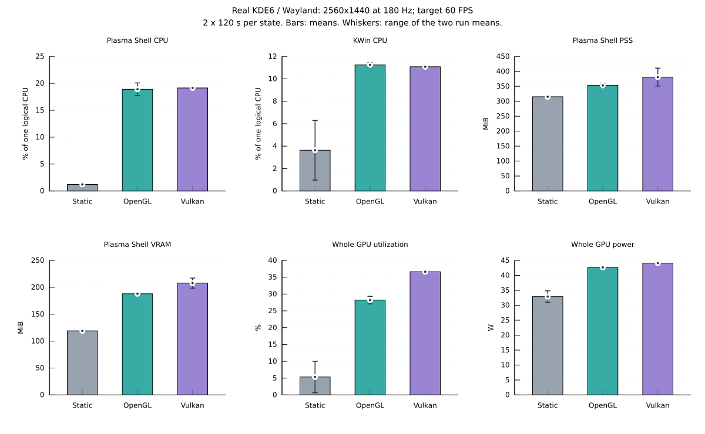

# 真实 Wayland / KDE6 桌面资源测量（2026-10-18）

D1，运行时代码基线 `88ea8fe00017e776a25e72d7024a0017300c66cb`。
用户授权在当前登录会话重装、启用与测试壁纸；执行者为 Codex，模型为 GPT-6
（精确变体未暴露）。本报告限定一台机器、一个角色的短时桌面运行。

在本次单屏 1440p、目标 60 FPS 条件下，相对前后两次干净静态基线的均值，
OpenGL 给 **Plasma Shell** 增加约 **17.7 个百分点的单逻辑 CPU 占用、
42.4 MiB RSS、69.0 MiB 进程显存**；Vulkan 分别增加约
**17.9 个百分点、84.1 MiB、88.7 MiB**。
单核 CPU 增量换算为本机 16 线程整机口径，约为 **1.10% / 1.12%**。
这些数值仅含 Plasma Shell，KWin 的额外合成开销另外列出。

两轮 Vulkan 的 RSS 均值相差约 69 MiB，内存重复性弱于 CPU；因此必须结合下方
逐轮范围阅读平均增量。OpenGL / Vulkan 的 Plasma Shell 平均 CPU 仅相差约
0.25 个百分点，小于 OpenGL 两轮自身约 2.37 个百分点的波动，不能据此判定
CPU 胜负。本机 Vulkan 的整卡利用率、板卡功耗和进程显存均高于两轮 OpenGL。



## 环境与构建

| 项目 | 本次条件 |
| --- | --- |
| 系统 | Manjaro Linux，Linux 6.6.107-1-MANJARO，x86_64 |
| CPU / 内存 | Xeon E5-1680 v4，8 核 / 16 线程，约 31.3 GiB RAM，schedutil |
| 桌面 | 真实 Wayland 登录会话，Plasma / KWin 6.3.6，宿主 Qt 6.9.2 |
| GPU | NVIDIA GeForce RTX 3080 Ti 12 GiB，驱动 580.82.09 |
| 显示 | 单屏 DP-2，2560×1440，179.999 Hz，缩放 1，HDR/VRR 关闭 |
| 合成 | KWin OpenGL / EGL，现有面板、主题与特效保留 |
| 角色 / 背景 | `chocola/casual-b-no-bell`，动态背景 `BG_47`，本次时段保持同一相位 |
| 应用设置 | 目标 60 FPS，中文，控制面板关闭、入口图标可见，原有位置/缩放保留 |
| 输入 / 音频 | 指针静止，不注入键鼠、不触发触摸；保留 `mute=false`，未测试有声交互 |
| 构建 | Debian 12 完整隔离工具链，GCC 12.2.0、Qt 6.4.2，Release + LTO + Werror，默认固定依赖 |

运行的是本次从当前源码重新构建的 `nekomote-plasma6-x86_64.tar.gz`，使用项目现有
`tools/ci_build.sh plasma6` 流程。源码只读挂载，依赖由已有的固定版本缓存提供，
没有在宿主安装构建依赖。必选 CPU/QML/工具 CTest **200/200 通过**，
Debian12 符号上限审计、主机 `check-host` 与重装后 12 个文件校验均通过。
GPU 与 integration 标签不包含在这 200 项中；实际桌面显示检查另见下文。

归档 SHA256：

```text
238a4b9e31f3ed814c33c5ee97bc6260e6f5edff2367cf421ac6115dd421f24c
```

实际安装的 `libnekomote_plasma_qml.so` SHA256：

```text
6d6c34690c089bea764682efd27b1fb1b6e812db495239562429a2f455b7dbf2
```

KPackage 元数据沿用源码中的历史 `Version: 0.1.0`；本次产物以源码提交与以上
哈希识别，不能凭设置页中的版本字符串判断代码新旧。测试后保留本次安装。

## 测量方法

1. 备份用户层安装文件、桌面配置与资产 `config.json`。先对原静态图片背景采样
   120 秒；当时 Plasma Shell 仍映射着旧版插件，RSS 约 604 MiB，只作原会话记录。
2. 用统一部署工具重新安装本次构建，更新本插件的 QML 导入环境，重启
   `plasma-plasmashell.service`。保持原图片壁纸，预热 45 秒、采样 120 秒，
   获得无旧插件映射的静态基线。
3. 仅通过 Plasma 的 `evaluateScript` 调整当前屏幕 containment 63 的壁纸配置，
   顺序为 OpenGL 1 → Vulkan 1 → OpenGL 2 → Vulkan 2。
   每轮预热 45 秒、采样 120 秒；第一轮 OpenGL 复用刚测完静态基线的进程，
   后三轮在选好后端后重启 Plasma Shell。KWin 始终使用同一 PID。
4. 切回原静态图片，保留当前 Plasma Shell 进程，预热 30 秒、采样 120 秒；
   再重启 Plasma Shell，预热 45 秒、采样 120 秒，得到最终干净静态基线。
5. 每轮采样结束后才使用 Spectacle 经合成器接口截图。两个后端各保留相隔约
   3 秒的两张截图，用于确认角色/背景显示及动画状态变化；不在采样窗口截图或读回像素。

采样器为 [plasma_desktop_measure.py](../tools/perf_compare/plasma_desktop_measure.py)。
每秒读取 `/proc/<pid>/stat` 与 NVIDIA NVML，每 5 秒读取一次 Plasma Shell
`smaps_rollup`；每轮包含 121 个时刻、120 个 CPU 差分区间。
CPU 均值用首尾累计时间差除以实际墙钟时间计算。

- **CPU 的 100% 等于一个逻辑 CPU**。本机 16 线程，换算成整机总算力口径需再除以 16。
- RSS 包含共享页；PSS 按映射共享者分摊，适合辅助观察进程内存。宿主禁止读取
  KWin 的 `smaps_rollup`，因此只报告其 RSS，不填造 KWin PSS。
- 进程显存来自 NVML graphics-process 归属统计，包含整个 Plasma Shell / KWin。
  不能把 Plasma Shell 的全部显存直接视为 NekoMote 的纹理显存。
- 整卡利用率、显存与功耗来自 NVML。显存使用 memory v2 的 `used`，驱动
  `reserved` 单列；最初探索采样使用 v1，包含 reserved，故 CSV 中不混入该列。
- 进程 GPU 利用率未获得：该驱动的 `nvidia-smi pmon` 对图形进程返回 `-`。
  整卡 GPU 百分比不归到某一个进程；功耗是显卡板卡功耗，不是整机墙上功耗。
- 保持终端最小化，未启动 btop/htop/nvtop 界面刷新。后台 Codex 与原有桌面服务仍在运行。
  临时通过会话抑制接口保持屏幕亮起，全部场景一致，测试后解除。

## 逐轮结果

全部为各轮均值，CPU 使用上述单逻辑 CPU 口径，内存/显存单位为 MiB。
最初含旧映射的静态记录与切回后的驻留记录不参与干净基线均值。

| 场景 | Plasma CPU % | Plasma RSS | Plasma PSS | Plasma 显存 | KWin CPU % | 整卡功耗 W |
| --- | ---: | ---: | ---: | ---: | ---: | ---: |
| 原会话静态（旧映射） | 1.09 | 603.84 | 476.43 | 127.07 | 0.75 | 30.93 |
| 重装后静态基线 | 1.20 | 507.98 | 317.14 | 119.07 | 6.29 | 34.82 |
| OpenGL 1 | 17.71 | 559.31 | 360.11 | 190.07 | 11.03 | 42.47 |
| Vulkan 1 | 19.14 | 559.03 | 350.92 | 198.41 | 10.99 | 43.98 |
| OpenGL 2 | 20.08 | 544.08 | 345.98 | 186.07 | 11.45 | 42.86 |
| Vulkan 2 | 19.14 | 627.72 | 410.86 | 217.16 | 11.17 | 44.20 |
| 切回静态，未重启 | 1.40 | 588.94 | 382.21 | 137.82 | 1.60 | 33.28 |
| 最终静态，已重启 | 1.23 | 510.55 | 313.18 | 119.07 | 0.97 | 30.98 |

静态基线取“重装后静态”与“最终静态”两轮均值；每个后端也取两轮均值。
下表增量等于相应后端均值减静态均值，不是独立进程的总占用。

| 指标 | 静态均值 | OpenGL 均值 / 增量 | Vulkan 均值 / 增量 |
| --- | ---: | ---: | ---: |
| Plasma 单逻辑 CPU % | 1.21 | 18.89 / +17.68 | 19.14 / +17.93 |
| Plasma RSS MiB | 509.27 | 551.70 / +42.43 | 593.37 / +84.11 |
| Plasma PSS MiB | 315.16 | 353.04 / +37.88 | 380.89 / +65.73 |
| Plasma 显存 MiB | 119.07 | 188.07 / +69.00 | 207.78 / +88.71 |
| KWin 单逻辑 CPU % | 3.63 | 11.24 / +7.61 | 11.08 / +7.45 |
| 整卡功耗 W | 32.90 | 42.66 / +9.76 | 44.09 / +11.19 |

KWin 静态 CPU 前后为 6.29% 与 0.97%，整卡静态功耗为 34.82 W 与 30.98 W，
说明静态阶段本身存在明显桌面活动/功耗状态波动。功耗和 KWin 增量应结合这两个
端点解释；图表误差线保留这一范围，不把均值差视为精确的因果归因。

| 场景 | Plasma CPU P50 / P95 / P99 % | KWin RSS MiB | KWin 显存 MiB | 整卡 GPU 利用率 % |
| --- | ---: | ---: | ---: | ---: |
| 重装后静态基线 | 1.00 / 2.00 / 3.00 | 453.65 | 130.03 | 10.01 |
| OpenGL 1 | 17.00 / 24.05 / 25.00 | 453.59 | 130.00 | 27.07 |
| Vulkan 1 | 19.00 / 25.00 / 26.00 | 453.66 | 129.44 | 36.52 |
| OpenGL 2 | 20.00 / 25.00 / 26.00 | 453.68 | 129.44 | 29.33 |
| Vulkan 2 | 18.00 / 25.00 / 26.00 | 401.03 | 125.44 | 36.72 |
| 最终静态，已重启 | 1.00 / 2.00 / 3.81 | 414.05 | 130.07 | 0.68 |

采样器每轮自身 CPU 时间约 0.36–0.47 秒 / 120 秒，折合约 0.30–0.39% 单逻辑 CPU；
它在独立 Python 进程中运行，不计入 Plasma Shell 或 KWin 的进程 CPU 数值。

## 显示检查、回收与范围

两种后端的四轮截图均显示角色、背景与 UI 入口，头部/发丝姿态随时间变化；
无可见 NekoMote 错误提示。这里验证的是本次场景能显示并推进，不是固定初态像素对照。
截图中心角色区域（排除面板/时钟）的相邻图像差分为 42.6%–52.5% 像素变化，
只辅助排除整幅冻结，不能用于推出帧率或渲染正确率。

本轮未出现非计划的 Plasma Shell 或 KWin 重启；所有采样窗口 PID 保持一致。
Plasma 有在测试前登录阶段就出现的面板扩展 `Error colorizing rect` 日志，
未将其归为 NekoMote 故障。Vulkan 桥销毁日志为 `validation=disabled, errors=0`，
验证层未启用，因此不能把该计数当作 Vulkan 验证层通过的证据。

Vulkan 第二轮在正式采样开始时 RSS 已约 626.2 MiB，结束约 627.9 MiB；
第一轮约 557.1 → 560.9 MiB。第二轮的偏高主要表现为起点差异，而非这两分钟内
持续积累。具体归属未定位，不能直接认定是运行时泄漏，也不能把它从结果中剔除。

从最后一轮 Vulkan 切回静态图片、保留同一进程后，CPU 回到 1.40%，但 RSS
仍为 588.94 MiB、显存 137.82 MiB。再次重启后的静态值为 510.55 MiB、119.07 MiB：
**切回静态后仍有约 78.39 MiB RSS 与 18.75 MiB 显存的进程驻留差异**。
其中可能包含 Qt、分配器、驱动缓存或应用对象，尚未逐项归因。
重启能恢复干净基线，本次不把“切回”描述成全部资源已归还操作系统。

最终保留新安装、恢复原 `org.kde.image` 图片背景；资产 `config.json` 字节与备份一致，
后端选择恢复为原默认 OpenGL。最终静态进程没有 NekoMote 库映射，KWin PID 856
贯穿整个实验，临时屏幕唤醒抑制已解除。没有改动用户其他桌面、显示模式或外部原仓库。

未采集实际 present 帧率、单帧 P50/P95/P99、CPU 封装功耗或整机功耗。
目标 60 FPS 不能视为实际呈现 60 FPS；表中的 CPU P95/P99 是一秒区间占用的
分位数，不是帧时间。没有通过普通窗口或隔离 KWin 的数据替代本次真实桌面数据。

本次没有覆盖多屏、其他角色、交互/声音、UI 展开、暂停/休眠、其他驱动或合成器，
也没有覆盖 8–24 小时运行。短时内存平台或两次相近结果不构成无泄漏证明。

## 复测与证据

在同样的桌面/模型/配置下，先启用需要测量的场景，再运行：

```bash
python3 tools/perf_compare/plasma_desktop_measure.py \
  --pid "plasmashell=$(pgrep -x plasmashell)" \
  --pid "kwin=$(pgrep -x kwin_wayland)" \
  --warmup 45 --seconds 120 --output build/desktop-repeat.jsonl
```

采样器要求 NVIDIA NVML memory v2，仅读取当前进程/设备计数，不会安装或切换壁纸。
复测时保留显示刷新率、后台程序与原有桌面插件，并明确是否重启过 Plasma Shell。

可提交的证据为 [逐秒 CSV](validation/plasma-desktop-2026-10-18/samples.csv)、
[统计与时间戳](validation/plasma-desktop-2026-10-18/results.json)、
[环境/构建/资产指纹](validation/plasma-desktop-2026-10-18/experiment.json) 和
[图表数据](validation/plasma-desktop-2026-10-18/chart.tsv)。图表由同目录
`gnuplot chart.gnuplot` 重建，误差线表示两轮均值的范围，不是置信区间。

原始 JSONL、构建/安装日志、配置备份、截图与事件日志保留在本机忽略目录
`build/evidence/desktop-20261018/`。游戏画面与用户配置不加入版本跟踪。
